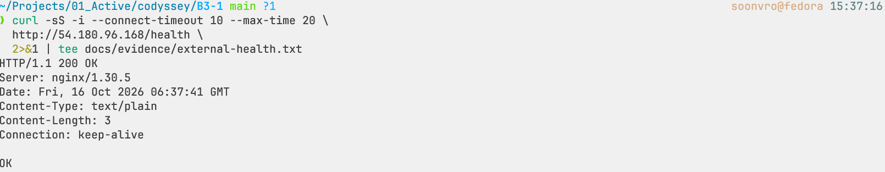
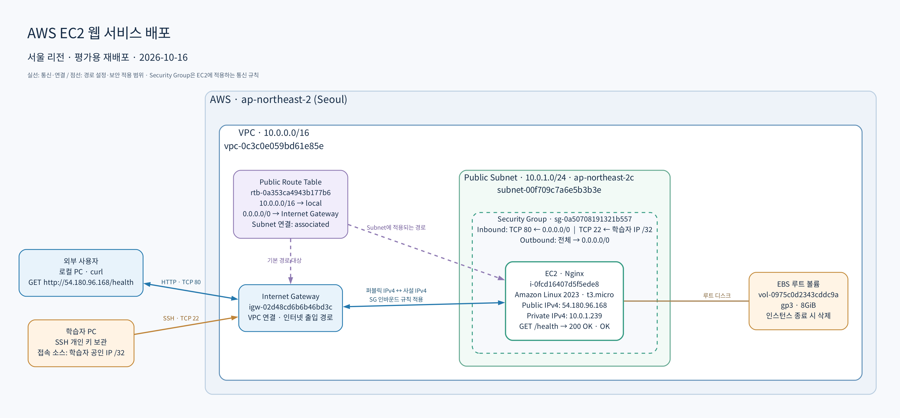

# AWS EC2 웹 서비스 배포 실습

2026-10-16 평가를 위해 서울 리전에 VPC와 Public Subnet을 구성하고 EC2에 Nginx 웹 서버를 다시 배포했다. SSH 접속, 서버 내부 응답, 인터넷 아웃바운드 통신을 확인하고 외부 PC에서 `/health`에 요청해 **HTTP 200과 본문 `OK`**를 확인했다.

**현재 상태: 평가용 웹 서버 운영 중 — 2026-10-16 15:37:41 KST 검증 기준.** 접속 URL은 **<http://54.180.96.168/health>**다. 2026-10-15 최초 실습 리소스는 정리했으며, 이번에 새로 생성한 리소스는 평가 종료 후 정리한다. 대상과 이전 정리 결과는 [정리 체크리스트](docs/cleanup-checklist.md)에 기록했다.

## 제출물

| 항목 | 파일 |
|---|---|
| 아키텍처 다이어그램 | [architecture.png](docs/architecture.png) |
| 외부 접속 스크린샷 | [external-health.png](docs/evidence/external-health.png) |
| 외부 접속 응답 원문 | [external-health.txt](docs/evidence/external-health.txt) |
| SSH 접속·서버 내부 검증 기록 | [internal-checks.txt](docs/evidence/internal-checks.txt) |
| 트러블슈팅 보고서 | [troubleshooting.md](docs/troubleshooting.md) |
| 리소스 정리 체크리스트 | [cleanup-checklist.md](docs/cleanup-checklist.md) |
| IAM 정책 | [lab-policy.json](infra/iam/lab-policy.json) |

## 외부 접속 검증

- 선택 방식: **B — `GET /health` 호출**
- 검증 URL: `http://54.180.96.168/health`
- 실행 위치: EC2 외부의 로컬 PC
- 응답 헤더의 시각: 2026-10-16 06:37:41 UTC / 15:37:41 KST
- 결과: `HTTP/1.1 200 OK`, 본문 `OK`

```bash
curl -sS -i --connect-timeout 10 --max-time 20 http://54.180.96.168/health
```

실제 응답:

```http
HTTP/1.1 200 OK
Server: nginx/1.30.5
Date: Fri, 16 Oct 2026 06:37:41 GMT
Content-Type: text/plain
Content-Length: 3
Connection: keep-alive

OK
```



위 주소는 이번 평가용 EC2에 자동 할당된 퍼블릭 IPv4다. 평가 종료 후 EC2를 삭제하면 주소가 반환되므로, 리소스 정리 후에는 접속 주소로 사용하지 않는다.

## 아키텍처와 요청 흐름



1. 외부 클라이언트가 EC2의 퍼블릭 IPv4 주소로 HTTP 요청을 보낸다.
2. VPC에 연결된 Internet Gateway를 통해 EC2의 사설 IP로 전달된다.
3. EC2에 적용한 Security Group의 TCP 80 허용 규칙을 통과한다.
4. Nginx가 `/health` 요청에 `200 OK`와 `OK`를 반환한다.
5. Subnet의 Route Table에 설정한 `0.0.0.0/0 → Internet Gateway` 경로를 통해 외부와 통신한다.

VPC는 분리된 네트워크 범위, Subnet은 그 안의 IP 구역이다. Route Table은 목적지에 따른 경로를 정하고 Internet Gateway는 VPC와 인터넷을 연결한다. Route Table은 요청을 처리하는 서버나 프록시가 아니다. Public Subnet의 IPv4 인터넷 통신에는 EC2의 퍼블릭 IP와 접근 허용 규칙도 필요하다. [AWS 인터넷 연결 설명](https://docs.aws.amazon.com/vpc/latest/userguide/VPC_Internet_Gateway.html)

## 배포 구성

아래는 2026-10-16 평가용 재배포의 조회 결과다.

| 구성 요소 | 값 |
|---|---|
| 리전 / 가용 영역 | `ap-northeast-2` / `ap-northeast-2c` |
| VPC | `vpc-0c3c0e059bd61e85e` · `10.0.0.0/16` |
| Public Subnet | `subnet-00f709c7a6e5b3b3e` · `10.0.1.0/24` · `available` |
| Internet Gateway | `igw-02d48cd6b6b46bd3c` |
| Route Table | `rtb-0a353ca4943b177b6` · 인터넷 경로 `active` |
| Route Table 연결 | `rtbassoc-024a91303aba8e958` · `associated` |
| Security Group | `sg-0a50708191321b557` |
| EC2 | `i-0fcd16407d5f5ede8` · `running` |
| 퍼블릭 / 사설 IPv4 | `54.180.96.168` / `10.0.1.239` |
| 선택한 인스턴스 유형 | `t3.micro` · 2 vCPU · 1,024MiB 메모리 |
| 선택한 AMI | `ami-0e716cbef3b043b93` |
| AMI 이름 | `al2023-ami-2023.12.20261014.0-kernel-6.18-x86_64` |
| EBS 볼륨 | `vol-0975c0d2343cddc9a` · `DeleteOnTermination: true` |
| 키페어 | `codyssey-eval` · RSA · `key-0e93a99ca48f480b9` |
| 메타데이터 접근 | `HttpTokens: required` · IMDSv2 필수 |
| 웹 서버 | 응답 헤더 기준 `nginx/1.30.5` |

생성 명령에는 EBS `gp3` 8GiB, `DeleteOnTermination=true`, CPU 크레딧 `standard`, IMDSv2 필수를 지정했다. EC2 조회 결과에서 연결된 볼륨의 `DeleteOnTermination: true`와 메타데이터의 `HttpTokens: required`를 확인했다. EBS 유형·용량과 CPU 크레딧 모드의 별도 조회 결과는 미기록이다. 인스턴스 유형 조회의 `FreeTierEligible=true`는 실제 청구 금액을 나타내지 않는다. Billing 조회는 결제 조회 권한 부족으로 제한됐으며, 비용·크레딧 내역은 미기록이다.

## 접근 제어와 IAM

| 방향 | 프로토콜 / 포트 | 출발지 또는 목적지 | 용도 |
|---|---|---|---|
| 인바운드 | TCP 80 | `0.0.0.0/0` | 외부 웹 접속 |
| 인바운드 | TCP 22 | 학습자 공인 IPv4 `/32` | SSH 관리 |
| 아웃바운드 | 전체 | `0.0.0.0/0` | 패키지 설치와 외부 통신 |

보안 그룹 조회 결과에는 위 두 인바운드 규칙만 존재하며 전체 포트를 공개하는 인바운드 규칙은 없다. 학습자의 공인 IP가 바뀌면 SSH 규칙도 새 `/32` 주소로 갱신한다.

Security Group은 서버로 오가는 네트워크 통신을 제어한다. IAM은 AWS API에서 리소스를 생성·조회·삭제할 수 있는 주체와 작업을 제어한다. 실습에는 IAM 사용자 `codyssey-lab`과 CLI 프로필 `codyssey`를 사용했다.

- `CodysseyLabInfrastructure`: EC2/VPC 실습에 필요한 작업을 열거하고 서울 리전으로 제한한다.
- `SignInLocalDevelopmentAccess`: `aws login`을 통한 CLI 임시 인증에 사용한다.
- 제공한 정책에 `AdministratorAccess`, IAM 권한 관리, S3·RDS 권한은 포함하지 않는다.
- `Resource: "*"`이므로 실습 태그나 특정 리소스 ID에만 권한을 한정하지는 않는다. 인스턴스 개수·종류·포트 제한은 실행 설정에서 관리한다.

계정 최초 준비와 루트 MFA 등록 후 실습용 IAM 사용자로 전환하는 절차를 사용했다. 전체 연결 정책 목록과 인증 ARN 원문은 제출 증거에 포함되지 않았다.

## 요구사항 확인 상태

| 요구사항 | 현재 근거와 상태 |
|---|---|
| VPC와 Public Subnet 구성 | 리소스 ID와 라우팅 조회 결과 |
| IGW 경로와 Subnet 연결 | 인터넷 경로 `active`, 연결 `associated` 확인 |
| EC2와 키페어 | `running`, `codyssey-eval` RSA 등록 및 EC2의 키페어 이름 확인 |
| HTTP 공개와 SSH 소스 제한 | 보안 그룹 조회 결과 확인 |
| Nginx 외부 응답 | 외부 `/health` 200 및 응답 원문·스크린샷 확보 |
| SSH 접속, 내부 `/` 200, 인터넷 아웃바운드 | `ec2-user` 접속, Nginx `active`, 내부 `/`·`/health` 200, 외부 HTTPS 200 확인 |
| IAM 최소권한 | 정책 파일 및 인증 설정 완료, 최종 연결 정책 목록 미기록 |
| 리소스 정리 | 최초 실습 리소스 정리 완료 · 현재 평가용 리소스는 평가 종료 후 정리 예정 |
| Billing 확인 (권장) | 결제 조회 권한 부족 · 청구 금액·크레딧 내역 미기록 |

### 서버 내부 검증

2026-10-16 06:35:19 UTC / 15:35:19 KST에 SSH로 접속한 EC2에서 확인했다. 원문은 [내부 검증 기록](docs/evidence/internal-checks.txt)에 저장했다.

| 검증 항목 | 실제 결과 |
|---|---|
| `whoami` | `ec2-user` |
| `hostname` | `ip-10-0-1-239.ap-northeast-2.compute.internal` |
| `systemctl is-active nginx` | `active` |
| `GET http://localhost/` | `HTTP/1.1 200 OK` · 본문 `Hello Cloud` |
| `GET http://localhost/health` | `HTTP/1.1 200 OK` · 본문 `OK` |
| `HEAD https://example.com` | `HTTP/2 200` · 인터넷 아웃바운드 통신 확인 |

## 트러블슈팅과 정리

2026-10-15 최초 배포에서 발생한 `--query` 식별자 줄바꿈 오류를 [트러블슈팅 보고서](docs/troubleshooting.md)에 기록했다. 오류 메시지 분석, 필드명 수정, 당시 인스턴스의 재조회 성공까지 포함한다.

최초 실습의 삭제 결과와 현재 평가용 리소스의 정리 대상은 [정리 체크리스트](docs/cleanup-checklist.md)에 구분했다. 이번 평가용 EC2·EBS·네트워크 리소스·키페어는 평가 종료 후 정리하고 결과를 기록한다. NAT Gateway·ELB/ALB·RDS는 본 실습 구성에 포함되지 않는다.

HTTPS와 Docker 보너스는 이번 제출 범위에 포함하지 않았다.

## 다이어그램 수정

편집 원본은 [architecture.dot](docs/diagrams/architecture.dot)이며 Graphviz로 PNG를 다시 만들 수 있다. 아래 명령은 AWS에 접근하지 않는다.

```bash
dot -Tpng docs/diagrams/architecture.dot -o docs/architecture.png
```
