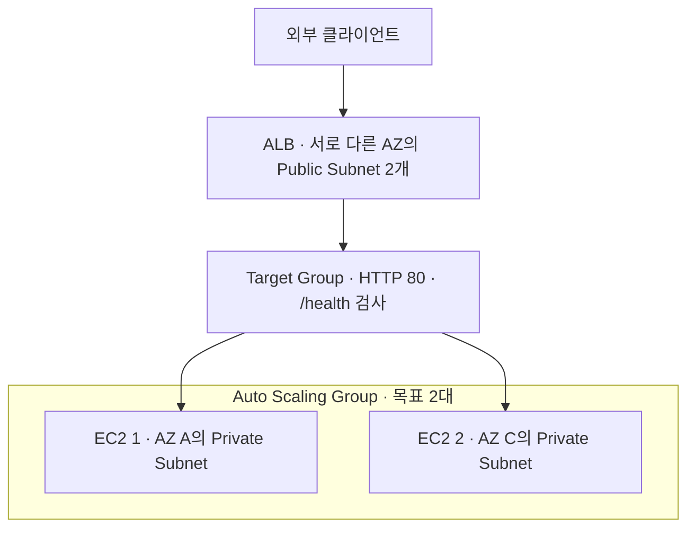

# AWS EC2 웹 서비스 배포 실습

2026-10-16 평가를 위해 서울 리전에 VPC와 Public Subnet을 구성하고 EC2에 Nginx 웹 서버를 다시 배포했다. SSH 접속, 서버 내부 응답, 인터넷 아웃바운드 통신을 확인하고 외부 PC에서 `/health`에 요청해 **HTTP 200과 본문 `OK`**를 확인했다.

**현재 상태: 평가용 웹 서버 운영 중 — 2026-10-16 15:37:41 KST 검증 기준.** 접속 URL은 **<http://54.180.96.168/health>**다. 2026-10-15 최초 실습 리소스는 정리했으며, 이번에 새로 생성한 리소스는 평가 종료 후 정리한다. 대상과 이전 정리 결과는 [정리 체크리스트](docs/cleanup-checklist.md)에 기록했다.

## 제출물

| 항목 | 파일 |
|---|---|
| 아키텍처 다이어그램 | [architecture.png](docs/architecture.png) |
| 외부 접속 스크린샷 | [external-health.png](docs/evidence/external-health.png) |
| 외부 접속 응답 원문 | [external-health.txt](docs/evidence/external-health.txt) |
| SSH 접속·서버 내부 검증 기록 | [internal-checks.txt](docs/evidence/internal-checks.txt) |
| 트러블슈팅 보고서 | [troubleshooting.md](docs/troubleshooting.md) |
| 리소스 정리 체크리스트 | [cleanup-checklist.md](docs/cleanup-checklist.md) |
| IAM 정책 | [lab-policy.json](infra/iam/lab-policy.json) |

## 외부 접속 검증

- 선택 방식: **B — `GET /health` 호출**
- 검증 URL: `http://54.180.96.168/health`
- 실행 위치: EC2 외부의 로컬 PC
- 응답 헤더의 시각: 2026-10-16 06:37:41 UTC / 15:37:41 KST
- 결과: `HTTP/1.1 200 OK`, 본문 `OK`

```bash
curl -sS -i --connect-timeout 10 --max-time 20 http://54.180.96.168/health
```

실제 응답:

```http
HTTP/1.1 200 OK
Server: nginx/1.30.5
Date: Fri, 16 Oct 2026 06:37:41 GMT
Content-Type: text/plain
Content-Length: 3
Connection: keep-alive

OK
```


위 주소는 이번 평가용 EC2에 자동 할당된 퍼블릭 IPv4다. 평가 종료 후 EC2를 삭제하면 주소가 반환되므로, 리소스 정리 후에는 접속 주소로 사용하지 않는다.

접속에 실패하면 [외부 접속 장애 점검 체크리스트](#외부-접속-장애-점검-체크리스트)에 따라 진단한다.

## 아키텍처와 요청 흐름


1. 외부 클라이언트가 EC2의 퍼블릭 IPv4 주소로 HTTP 요청을 보낸다.
2. VPC에 연결된 Internet Gateway를 통해 EC2의 사설 IP로 전달된다.
3. EC2에 적용한 Security Group의 TCP 80 허용 규칙을 통과한다.
4. Nginx가 `/health` 요청에 `200 OK`와 `OK`를 반환한다.
5. Subnet의 Route Table에 설정한 `0.0.0.0/0 → Internet Gateway` 경로를 통해 외부와 통신한다.

VPC는 분리된 네트워크 범위, Subnet은 그 안의 IP 구역이다. Route Table은 목적지에 따른 경로를 정하고 Internet Gateway는 VPC와 인터넷을 연결한다. Route Table은 요청을 처리하는 서버나 프록시가 아니다. Public Subnet의 IPv4 인터넷 통신에는 EC2의 퍼블릭 IP와 접근 허용 규칙도 필요하다. [AWS 인터넷 연결 설명](https://docs.aws.amazon.com/vpc/latest/userguide/VPC_Internet_Gateway.html)

## 배포 구성

아래는 2026-10-16 평가용 재배포의 조회 결과다.

| 구성 요소 | 값 |
|---|---|
| 리전 / 가용 영역 | `ap-northeast-2` / `ap-northeast-2c` |
| VPC | `vpc-0c3c0e059bd61e85e` · `10.0.0.0/16` |
| Public Subnet | `subnet-00f709c7a6e5b3b3e` · `10.0.1.0/24` · `available` |
| Internet Gateway | `igw-02d48cd6b6b46bd3c` |
| Route Table | `rtb-0a353ca4943b177b6` · 인터넷 경로 `active` |
| Route Table 연결 | `rtbassoc-024a91303aba8e958` · `associated` |
| Security Group | `sg-0a50708191321b557` |
| EC2 | `i-0fcd16407d5f5ede8` · `running` |
| 퍼블릭 / 사설 IPv4 | `54.180.96.168` / `10.0.1.239` |
| 선택한 인스턴스 유형 | `t3.micro` · 2 vCPU · 1,024MiB 메모리 |
| 선택한 AMI | `ami-0e716cbef3b043b93` |
| AMI 이름 | `al2023-ami-2023.12.20261014.0-kernel-6.18-x86_64` |
| EBS 볼륨 | `vol-0975c0d2343cddc9a` · `DeleteOnTermination: true` |
| 키페어 | `codyssey-eval` · RSA · `key-0e93a99ca48f480b9` |
| 메타데이터 접근 | `HttpTokens: required` · IMDSv2 필수 |
| 웹 서버 | 응답 헤더 기준 `nginx/1.30.5` |

생성 명령에는 EBS `gp3` 8GiB, `DeleteOnTermination=true`, CPU 크레딧 `standard`, IMDSv2 필수를 지정했다. EC2 조회 결과에서 연결된 볼륨의 `DeleteOnTermination: true`와 메타데이터의 `HttpTokens: required`를 확인했다. EBS 유형·용량과 CPU 크레딧 모드의 별도 조회 결과는 미기록이다. 인스턴스 유형 조회의 `FreeTierEligible=true`는 실제 청구 금액을 나타내지 않는다. Billing 조회는 결제 조회 권한 부족으로 제한됐으며, 비용·크레딧 내역은 미기록이다.

## 태그·이름 규칙과 리소스 추적

직접 생성한 평가용 리소스 8개에 아래 규칙을 적용했다. **태그 적용 확인 완료:** `describe-tags` 조회에서 배포 구성 표의 8개 리소스 각각에 `Name`·`project`·`env`·`resource-type` 네 가지 태그가 있는지 확인했다. 총 32개 항목의 값이 아래 규칙과 일치한다.

### 태그와 이름 규칙

| 태그 키 | 값 또는 규칙 | 용도 |
|---|---|---|
| `project` | `codyssey-b3-1` | 이 과제에서 생성한 리소스 식별 |
| `env` | `eval` | 평가용 배포 구분 |
| `resource-type` | 아래 표의 리소스 유형 | 리소스 종류별 분류 |
| `Name` | `codyssey-{env}-{역할}` | 콘솔에서 읽기 쉬운 표시 이름 |

태그 키는 위 대소문자를 그대로 사용한다. 값에는 영문 소문자·숫자·하이픈을 사용한다. `Name` 태그는 표시 이름이며, 리소스의 고유 식별자는 위 배포 구성 표의 ID다. AWS 태그는 대소문자를 구분하고 리소스 간에 자동으로 복사되지 않으므로, EC2와 EBS 등 각각에 지정한다. [AWS 태그 설명](https://docs.aws.amazon.com/AWSEC2/latest/UserGuide/Using_Tags.html)

| 대상 | `resource-type` | 확인한 `Name` |
|---|---|---|
| VPC | `vpc` | `codyssey-eval-vpc` |
| Public Subnet | `subnet` | `codyssey-eval-public-subnet` |
| Internet Gateway | `internet-gateway` | `codyssey-eval-igw` |
| Route Table | `route-table` | `codyssey-eval-public-rt` |
| Security Group | `security-group` | `codyssey-eval-web-sg` |
| EC2 | `instance` | `codyssey-eval-web` |
| EBS 루트 볼륨 | `volume` | `codyssey-eval-root` |
| 키페어 | `key-pair` | `codyssey-eval-keypair` |

키페어의 실제 `KeyName`은 `codyssey-eval`로 유지한다. 위 `Name` 태그는 별도 표시 이름이다. Route Table 연결 ID는 Route Table·Subnet과 함께 기록한다. EC2의 네트워크 인터페이스와 VPC 생성 시 함께 만들어지는 기본 리소스는 부모 EC2·VPC와의 연결 관계로 추적한다. Amazon이 제공하는 AMI는 이 과제의 생성·정리 대상에서 제외한다.

### 추적 방법

1. 생성 직후 리소스 ID를 위 배포 구성 표와 [정리 체크리스트](docs/cleanup-checklist.md)에 기록한다.
2. 공통 태그를 적용한 뒤 아래 명령으로 프로젝트 리소스의 ID·유형을 조회하고, 기록한 8개 리소스와 대조한다.
3. 평가 전 EC2 상태와 접속 IP를 조회하고, 변경되면 README와 아키텍처를 갱신한다.
4. 평가 종료 후 체크리스트의 ID로 정리하고, 각 리소스의 조회 결과로 삭제 여부를 확인한다. 태그 검색 결과가 비었다는 것만으로 삭제 완료를 판단하지 않는다.

프로젝트 태그가 있는 리소스 목록 조회:

```bash
aws ec2 describe-tags \
  --profile codyssey \
  --region ap-northeast-2 \
  --filters \
    'Name=key,Values=project' \
    'Name=value,Values=codyssey-b3-1' \
  --query 'sort_by(Tags, &ResourceId)[].{
    ResourceId:ResourceId,
    ResourceType:ResourceType,
    Project:Value
  }' \
  --output json \
  --no-cli-pager
```

프로젝트·환경 태그로 평가용 EC2 조회:

```bash
aws ec2 describe-instances \
  --profile codyssey \
  --region ap-northeast-2 \
  --filters \
    'Name=tag:project,Values=codyssey-b3-1' \
    'Name=tag:env,Values=eval' \
  --query 'Reservations[].Instances[].{
    InstanceId:InstanceId,
    State:State.Name,
    PublicIp:PublicIpAddress,
    Tags:Tags
  }' \
  --output json \
  --no-cli-pager
```

`describe-tags`는 태그별 행을 반환하므로 `project` 태그의 키와 값으로 목록을 찾고, `describe-instances`는 `tag:project`와 `tag:env`로 인스턴스를 필터링한다. 현재 [IAM 정책](infra/iam/lab-policy.json)에는 서울 리전의 `ec2:CreateTags`·`ec2:DescribeTags`·`ec2:DescribeInstances` 권한이 포함되어 있다. 이 태그 규칙은 리소스 분류·추적용이며, 현재 정책의 접근 권한을 태그로 제한하지는 않는다. [태그 조회 명령](https://docs.aws.amazon.com/cli/latest/reference/ec2/describe-tags.html)

## 접근 제어와 IAM

| 방향 | 프로토콜 / 포트 | 출발지 또는 목적지 | 용도 |
|---|---|---|---|
| 인바운드 | TCP 80 | `0.0.0.0/0` | 외부 웹 접속 |
| 인바운드 | TCP 22 | 학습자 공인 IPv4 `/32` | SSH 관리 |
| 아웃바운드 | 전체 | `0.0.0.0/0` | 패키지 설치와 외부 통신 |

보안 그룹 조회 결과에는 위 두 인바운드 규칙만 존재하며 전체 포트를 공개하는 인바운드 규칙은 없다. 학습자의 공인 IP가 바뀌면 SSH 규칙도 새 `/32` 주소로 갱신한다.

Security Group은 서버로 오가는 네트워크 통신을 제어한다. IAM은 AWS API에서 리소스를 생성·조회·삭제할 수 있는 주체와 작업을 제어한다. 실습에는 IAM 사용자 `codyssey-lab`과 CLI 프로필 `codyssey`를 사용했다.

- `CodysseyLabInfrastructure`: EC2/VPC 실습에 필요한 작업을 열거하고 서울 리전으로 제한한다.
- `SignInLocalDevelopmentAccess`: `aws login`을 통한 CLI 임시 인증에 사용한다.
- 제공한 정책에 `AdministratorAccess`, IAM 권한 관리, S3·RDS 권한은 포함하지 않는다.
- `Resource: "*"`이므로 실습 태그나 특정 리소스 ID에만 권한을 한정하지는 않는다. 인스턴스 개수·종류·포트 제한은 실행 설정에서 관리한다.

계정 최초 준비와 루트 MFA 등록 후 실습용 IAM 사용자로 전환하는 절차를 사용했다. 전체 연결 정책 목록과 인증 ARN 원문은 제출 증거에 포함되지 않았다.

## 요구사항 확인 상태

| 요구사항 | 현재 근거와 상태 |
|---|---|
| VPC와 Public Subnet 구성 | 리소스 ID와 라우팅 조회 결과 |
| IGW 경로와 Subnet 연결 | 인터넷 경로 `active`, 연결 `associated` 확인 |
| EC2와 키페어 | `running`, `codyssey-eval` RSA 등록 및 EC2의 키페어 이름 확인 |
| HTTP 공개와 SSH 소스 제한 | 보안 그룹 조회 결과 확인 |
| Nginx 외부 응답 | 외부 `/health` 200 및 응답 원문·스크린샷 확보 |
| SSH 접속, 내부 `/` 200, 인터넷 아웃바운드 | `ec2-user` 접속, Nginx `active`, 내부 `/`·`/health` 200, 외부 HTTPS 200 확인 |
| IAM 최소권한 | 정책 파일 및 인증 설정 완료, 최종 연결 정책 목록 미기록 |
| 태그·이름 규칙과 추적 | 8개 리소스의 태그 32개 항목 확인 · 이름 규칙, 태그 조회 명령, ID 기반 정리 절차 문서화 |
| 외부 접속 장애 점검 | 라우팅 → SG → 퍼블릭 IP → 서버 순서의 검사 명령·정상 출력 예시·후속 조치 문서화 |
| 리소스 정리 | 최초 실습 리소스 정리 완료 · 현재 평가용 리소스는 평가 종료 후 정리 예정 |
| Billing 확인 (권장) | 결제 조회 권한 부족 · 청구 금액·크레딧 내역 미기록 |

### 서버 내부 검증

2026-10-16 06:35:19 UTC / 15:35:19 KST에 SSH로 접속한 EC2에서 확인했다. 원문은 [내부 검증 기록](docs/evidence/internal-checks.txt)에 저장했다.

| 검증 항목 | 실제 결과 |
|---|---|
| `whoami` | `ec2-user` |
| `hostname` | `ip-10-0-1-239.ap-northeast-2.compute.internal` |
| `systemctl is-active nginx` | `active` |
| `GET http://localhost/` | `HTTP/1.1 200 OK` · 본문 `Hello Cloud` |
| `GET http://localhost/health` | `HTTP/1.1 200 OK` · 본문 `OK` |
| `HEAD https://example.com` | `HTTP/2 200` · 인터넷 아웃바운드 통신 확인 |

## 외부 접속 장애 점검 체크리스트

외부에서 `/health`에 접속되지 않으면 **라우팅 → Security Group → 퍼블릭 IP → 서버 프로세스** 순서로 확인한다.

- [ ] 1. Subnet에 적용되는 Route Table과 IGW 기본 경로 확인
- [ ] 2. EC2에 연결된 Security Group과 TCP 80 허용 규칙 확인
- [ ] 3. EC2 실행 상태와 현재 퍼블릭 IPv4 확인
- [ ] 4. Nginx 프로세스·수신 포트·설정·내부 응답 확인 후 외부 재검증

명령은 학습자가 직접 실행한다. 1~3단계는 **로컬 Fedora PC**, 4단계의 서버 검사는 **SSH로 접속한 EC2**에서 실행한다. 아래 출력은 정상 상태를 판단하기 위한 **예시**이며, 실제 검증 기록은 앞의 외부·내부 검증 절에 있다. IP·리소스 ID·PID는 점검 시점의 값과 대조한다. CLI 인증 만료나 `UnauthorizedOperation`이 나오면 인증·조회 권한을 먼저 확인한다.

로컬 PC의 같은 터미널에서 점검 대상을 설정한다. 재배포했다면 배포 구성 표의 최신 ID로 바꾼다.

```bash
vpc_id="vpc-0c3c0e059bd61e85e"
subnet_id="subnet-00f709c7a6e5b3b3e"
instance_id="i-0fcd16407d5f5ede8"
```

### 1. 라우팅 확인

Subnet에 명시적으로 연결된 Route Table을 조회한다.

```bash
aws ec2 describe-route-tables \
  --profile codyssey \
  --region ap-northeast-2 \
  --filters "Name=association.subnet-id,Values=$subnet_id" \
  --query 'RouteTables[].{
    RouteTableId:RouteTableId,
    DefaultRoute:Routes[?DestinationCidrBlock==`0.0.0.0/0`].{
      GatewayId:GatewayId,
      State:State
    },
    Associations:Associations[].{
      SubnetId:SubnetId,
      State:AssociationState.State
    }
  }' \
  --output json \
  --no-cli-pager
```

정상 출력 예시:

```json
[
  {
    "RouteTableId": "rtb-0a353ca4943b177b6",
    "DefaultRoute": [
      {"GatewayId": "igw-02d48cd6b6b46bd3c", "State": "active"}
    ],
    "Associations": [
      {"SubnetId": "subnet-00f709c7a6e5b3b3e", "State": "associated"}
    ]
  }
]
```

`DefaultRoute`에 올바른 IGW가 있고 상태가 `active`인지, 대상 Subnet의 연결 상태가 `associated`인지 확인한다. 기본 경로가 없거나 `blackhole`이면 IGW의 VPC 연결과 경로 대상을 점검하고 수정한다.

조회 결과가 `[]`이면 명시적 연결이 없는 경우일 수 있다. 이때 Subnet에 적용되는 **VPC 메인 Route Table**을 조회하고 같은 기본 경로 조건을 확인한다. [AWS Route Table 조회 설명](https://docs.aws.amazon.com/cli/latest/reference/ec2/describe-route-tables.html)

```bash
aws ec2 describe-route-tables \
  --profile codyssey \
  --region ap-northeast-2 \
  --filters \
    "Name=vpc-id,Values=$vpc_id" \
    'Name=association.main,Values=true' \
  --query 'RouteTables[].{RouteTableId:RouteTableId,Routes:Routes}' \
  --output json \
  --no-cli-pager
```

### 2. Security Group 확인

먼저 EC2에 실제로 연결된 보안 그룹 ID를 확인한다.

```bash
aws ec2 describe-instances \
  --profile codyssey \
  --region ap-northeast-2 \
  --instance-ids "$instance_id" \
  --query 'Reservations[].Instances[].SecurityGroups[].GroupId' \
  --output text \
  --no-cli-pager
```

정상 출력 예시:

```text
sg-0a50708191321b557
```

조회된 ID를 다음 명령의 `--group-ids`에 넣는다. 여러 그룹이 연결되어 있으면 모든 ID를 공백으로 구분해 조회한다.

```bash
aws ec2 describe-security-groups \
  --profile codyssey \
  --region ap-northeast-2 \
  --group-ids sg-0a50708191321b557 \
  --query 'SecurityGroups[].{
    GroupId:GroupId,
    Inbound:IpPermissions[].{
      Protocol:IpProtocol,
      From:FromPort,
      To:ToPort,
      CIDRs:IpRanges[].CidrIp
    },
    Outbound:IpPermissionsEgress[].{
      Protocol:IpProtocol,
      CIDRs:IpRanges[].CidrIp
    }
  }' \
  --output json \
  --no-cli-pager
```

정상 출력 예시. SSH 소스의 `203.0.113.10/32`는 설명용 주소이며 실제 규칙은 현재 PC의 공인 IPv4와 대조한다.

```json
[
  {
    "GroupId": "sg-0a50708191321b557",
    "Inbound": [
      {"Protocol": "tcp", "From": 80, "To": 80, "CIDRs": ["0.0.0.0/0"]},
      {"Protocol": "tcp", "From": 22, "To": 22, "CIDRs": ["203.0.113.10/32"]}
    ],
    "Outbound": [
      {"Protocol": "-1", "CIDRs": ["0.0.0.0/0"]}
    ]
  }
]
```

HTTP에는 TCP 80 인바운드 허용이 필요하다. 규칙이 없으면 해당 보안 그룹에 추가하고, 다른 그룹에만 규칙이 있으면 EC2의 그룹 연결을 점검한다. SSH 접속도 실패한다면 TCP 22의 허용 소스가 현재 PC의 공인 IPv4 `/32`인지 확인한다. 이 실습의 아웃바운드 `Protocol: -1`은 모든 프로토콜 허용을 뜻한다. [AWS 웹·SSH 보안 그룹 규칙](https://docs.aws.amazon.com/AWSEC2/latest/UserGuide/security-group-rules-reference.html)

### 3. 퍼블릭 IP 확인

```bash
aws ec2 describe-instances \
  --profile codyssey \
  --region ap-northeast-2 \
  --instance-ids "$instance_id" \
  --query 'Reservations[].Instances[].{
    InstanceId:InstanceId,
    State:State.Name,
    PublicIp:PublicIpAddress,
    SubnetId:SubnetId
  }' \
  --output json \
  --no-cli-pager
```

정상 출력 예시:

```json
[
  {
    "InstanceId": "i-0fcd16407d5f5ede8",
    "State": "running",
    "PublicIp": "54.180.96.168",
    "SubnetId": "subnet-00f709c7a6e5b3b3e"
  }
]
```

- `State`가 `running`인지 확인한다. 다른 상태라면 인스턴스 상태의 원인을 먼저 확인한다.
- `PublicIp`가 `null`이면 퍼블릭 IPv4 할당 구성을 점검한다. 이 구성에서는 사설 IP로 인터넷에서 직접 접속할 수 없다.
- 조회된 IP와 브라우저·`curl`의 대상 IP가 다르면 최신 IP로 바꾼다. 이 실습의 접속 방식은 **HTTP, TCP 80**이다.
- `SubnetId`가 1단계 대상과 다르면 실제 Subnet과 그 VPC를 기준으로 라우팅을 다시 확인한다. [AWS IPv4 인터넷 연결 조건](https://docs.aws.amazon.com/vpc/latest/userguide/VPC_Internet_Gateway.html)

`running`과 유효한 퍼블릭 IP를 확인한 뒤, 이후 접속에 사용할 현재 주소를 변수에 저장한다.

```bash
public_ip=$(aws ec2 describe-instances \
  --profile codyssey \
  --region ap-northeast-2 \
  --instance-ids "$instance_id" \
  --query 'Reservations[0].Instances[0].PublicIpAddress' \
  --output text \
  --no-cli-pager)
```

### 4. 서버 프로세스와 내부 응답 확인

로컬 PC에서 현재 IP로 SSH에 접속한다. SSH가 실패하면 2단계의 TCP 22 소스 제한, 3단계의 IP, 키페어 `codyssey-eval`과 개인 키 파일의 일치 여부를 확인한다.

```bash
ssh -i "$HOME/.ssh/codyssey-eval.pem" "ec2-user@${public_ip}"
```

**접속에 성공한 EC2 터미널에서** 다음을 실행한다.

```bash
systemctl is-active nginx
sudo ss -lntp 'sport = :80'
sudo nginx -t
curl -sS -i --connect-timeout 10 --max-time 20 http://127.0.0.1/health
```

정상 출력 예시의 핵심 부분이다. `ss`의 PID·파일 디스크립터와 HTTP의 일부 헤더는 환경에 따라 달라진다.

```text
active

LISTEN 0 511 0.0.0.0:80 0.0.0.0:* users:(("nginx",pid=1234,fd=6))
LISTEN 0 511 [::]:80 [::]:* users:(("nginx",pid=1234,fd=7))

nginx: the configuration file /etc/nginx/nginx.conf syntax is ok
nginx: configuration file /etc/nginx/nginx.conf test is successful

HTTP/1.1 200 OK
Content-Type: text/plain
Content-Length: 3

OK
```

| 확인 결과 | 다음 점검·조치 |
|---|---|
| `inactive` 또는 `failed` | 아래 서비스 로그와 Nginx 오류 로그에서 시작 실패 원인 확인 |
| TCP 80의 `LISTEN`이 없음 | Nginx 실행 여부와 `listen 80` 설정 확인 |
| `127.0.0.1:80`에서만 수신 | 외부 요청을 받을 수 있도록 수신 주소 설정 확인; 이 실습의 정상 설정은 `0.0.0.0:80`과 `[::]:80` |
| `nginx -t` 실패 | 오류에 표시된 설정 파일·행을 수정한 뒤 다시 검사 |
| 내부 `/health`가 404 등으로 응답 | `location = /health`와 요청을 처리하는 `server` 설정 확인 |

포트·설정 검사 방법은 [ss 매뉴얼](https://man7.org/linux/man-pages/man8/ss.8.html), [Nginx 설정 검사 설명](https://nginx.org/en/docs/switches.html)을 참고한다. 서비스 시작 실패나 HTTP 오류의 원인은 다음 로그에서 확인한다.

```bash
sudo journalctl -u nginx -n 50 --no-pager
sudo tail -n 50 /var/log/nginx/error.log
```

원인을 수정해 서비스 시작 또는 설정 반영이 필요하면, 설정 검사가 성공한 경우에만 재시작하고 내부 `/health`를 다시 확인한다.

```bash
sudo nginx -t && sudo systemctl restart nginx
curl -sS -i --connect-timeout 10 --max-time 20 http://127.0.0.1/health
```

### 조치 후 외부 재검증

SSH 세션에서 `exit`로 **로컬 Fedora PC**에 돌아온 뒤 실행한다. `public_ip`는 3단계에서 로컬 터미널에 저장한 값이다.

```bash
curl -sS -i --connect-timeout 10 --max-time 20 "http://${public_ip}/health"
```

정상 판정은 `HTTP/1.1 200 OK`와 본문 `OK`다. 내부 응답과 수신 주소가 정상인데 외부에서 계속 타임아웃되면 네트워크 ACL, 서버 OS 방화벽, 로컬 네트워크·프록시를 추가 점검한다. 장애 시각·오류 메시지·단계별 결과·변경한 설정·외부 재검증 결과를 기록한다.

## 운영 상황별 대응

아래는 현재 실습 구성을 바탕으로 한 대응 방안이다. 권한 변경, EC2 2대 확장, 비용 조사·정리를 추가로 수행한 결과는 아니다.

### IAM 권한이 부족해 작업이 실패했다면, 필요한 최소 범위를 어떻게 찾는가?

**실패한 요청의 주체·작업·리소스·조건을 확인하고, 실제로 필요한 권한만 좁혀서 추가한다.** `AdministratorAccess`나 `ec2:*`를 붙여 해결하지 않는다.

1. **실패 요청을 특정한다.** 실행한 명령, 프로필·리전, 오류 코드, 요청 시각·Request ID를 기록한다. 오류에 나온 사용자/Role ARN, 거부된 Action, 대상 리소스 ARN을 확인한다. 인증 만료나 잘못된 프로필은 인증 설정을 바로잡고, `AccessDenied`·`UnauthorizedOperation`은 정책을 점검한다. 인증 토큰·비밀 키는 기록하지 않는다.
2. **현재 허용 범위와 대조한다.** [실습 정책](infra/iam/lab-policy.json)의 `Action`, `Resource`, `Condition`과 실제 연결된 정책을 확인한다. 예를 들어 `ec2:DescribeInstances`는 이미 허용되어 있지만 `aws:RequestedRegion`은 `ap-northeast-2`로 제한되어 있다. 다른 리전으로 잘못 요청했다면 서울 리전으로 수정한다.
3. **허용 누락과 명시적 거부를 구분한다.** 해당 요청에 적용되는 사용자·그룹·Role 정책, 권한 경계, 세션 정책, 조직의 SCP 등을 확인한다. 명시적 `Deny`는 `Allow`를 추가해도 해소되지 않는다. 필요한 경우 관리자가 CloudTrail의 해당 이벤트와 정책 평가를 함께 확인한다. [AWS 접근 거부 진단](https://docs.aws.amazon.com/IAM/latest/UserGuide/troubleshoot_access-denied.html)
4. **작업별로 최소 권한을 설계한다.** 필요한 Action만 열거하고, 리소스 수준 권한을 지원하면 대상 ARN으로 제한한다. 지원되는 리전·태그 조건도 검토한다. `ec2:DescribeInstances`처럼 리소스 수준 제한을 지원하지 않는 조회 작업은 `Resource: "*"`가 필요하므로 변경 작업과 문장을 분리한다. `RunInstances`는 AMI·Subnet·SG·EBS 등 여러 리소스를 사용하며, 생성 시 태그를 붙이면 `ec2:CreateTags`도 필요하다. 인스턴스 Role을 전달하는 경우에만 해당 Role에 대한 `iam:PassRole` 필요 여부를 검토한다. [EC2 작업별 정책 예시](https://docs.aws.amazon.com/AWSEC2/latest/UserGuide/ExamplePolicies_EC2.html)
5. **작게 변경하고 검증한다.** 관리자가 필요한 정책 부분만 수정한다. 지원되는 작업은 `--dry-run` 또는 IAM Policy Simulator로 먼저 검토하고, 원래 요청을 재검증한다. 생성·삭제 요청은 재시도 전에 현재 상태를 확인한다. 범위 밖 리소스·작업은 계속 거부되는지도 확인하고, 추가한 권한과 근거를 기록한다.

예를 들어 평가용 EC2의 **중지**가 새로 필요하다면, 현재 정책에 없는 `ec2:StopInstances`를 해당 인스턴스 ARN과 서울 리전으로 제한해 추가하는 방안을 검토한다. 단순 조회 실패를 해결하기 위해 중지·삭제 권한까지 추가할 이유는 없다. CloudTrail 조회, 정책 시뮬레이션, IAM 정책 수정 권한은 현재 실습 정책에 포함되어 있지 않으므로 해당 권한을 가진 관리자가 수행한다.

### 트래픽이 늘어 인스턴스를 2대로 늘린다면, 병목과 추가 구성은 무엇인가?

현재는 모든 요청이 `t3.micro` 한 대의 퍼블릭 IP로 들어간다. **한 서버의 처리 용량이 확장 한계이며, 서버나 가용 영역에 장애가 생기면 서비스가 중단되는 구조**다. 실제 성능 병목은 아직 측정하지 않았으므로 요청 지연·오류율과 CPU·메모리·네트워크·디스크 사용량을 함께 확인한다. 인스턴스를 한 대 더 생성해도 기존 IP로 보내는 요청은 자동으로 분산되지 않는다.

**확장안:** 인터넷 공개 ALB(Application Load Balancer)가 요청을 받고, 서로 다른 가용 영역의 EC2 두 대로 분산한다. 아래는 제안 구성이다.



| 구성 요소 | 추가·변경 내용과 이유 |
|---|---|
| Subnet | 현재 `ap-northeast-2c` 외의 가용 영역에 Public Subnet을 추가한다. 서울 리전의 ALB에는 서로 다른 가용 영역의 Subnet이 최소 2개 필요하다. EC2용 Private Subnet도 각 가용 영역에 준비한다. |
| ALB·Listener·Target Group | ALB의 HTTP 80 Listener가 EC2 두 대의 HTTP 80으로 전달하도록 설정한다. 클라이언트 접속 주소는 ALB DNS 이름으로 바꾼다. |
| 헬스체크 | Target Group에 `/health`, 성공 코드 `200`을 설정한다. 한 대가 검사에 실패하고 다른 한 대가 정상이라면 정상 서버로 요청을 보낸다. |
| Security Group | ALB는 외부 HTTP를 허용한다. EC2의 HTTP 인바운드는 출발지를 ALB의 SG로 제한하고, ALB의 아웃바운드는 대상 서버의 서비스·헬스체크 포트에 도달하도록 허용한다. |
| Launch Template·Auto Scaling Group | 동일한 AMI·Nginx 설정으로 서버를 만들고 목표·최소 용량을 2대로 설정한다. 두 가용 영역에 배치하고 ELB 헬스체크를 활성화해 비정상 인스턴스를 교체하도록 한다. |

구성 근거: [ALB와 Subnet 요건](https://docs.aws.amazon.com/elasticloadbalancing/latest/application/application-load-balancers.html), [Target Group 헬스체크](https://docs.aws.amazon.com/elasticloadbalancing/latest/application/target-group-health-checks.html), [ALB 보안 그룹](https://docs.aws.amazon.com/elasticloadbalancing/latest/application/load-balancer-update-security-groups.html), [Auto Scaling의 장애 대응](https://docs.aws.amazon.com/autoscaling/ec2/userguide/auto-scaling-benefits.html).

현재 응답은 고정 문자열이므로 두 서버에 같은 설정을 배포하면 된다. 추후 로그인 세션·업로드 파일·DB를 사용한다면 서버 로컬에만 상태를 저장하지 않도록 공유 저장소를 설계하고, DB 등의 병목도 별도로 확인한다. Private Subnet에서는 패키지 설치 등 외부 통신을 위한 NAT Gateway 등의 경로와 관리 접속 방식을 별도로 설계해야 한다.

확장 후에는 두 대상의 `healthy`, ALB를 통한 `/health` 200, 한 대 장애 시 나머지 서버의 응답을 검증한다. EC2 두 대·ALB·필요 시 NAT Gateway의 비용을 먼저 산정하고, 현재 정책에 없는 ALB·Auto Scaling 등의 권한은 앞의 IAM 최소권한 확인 절차로 검토한다.

### Billing에 예상치 못한 비용이 찍혔다면, 무엇부터 추적하고 정리하는가?

**청구 항목의 서비스·리전·사용 유형부터 확인한 뒤, 해당 리소스 ID와 연결해 원인을 찾는다.** 현재 `codyssey-lab`은 결제 조회 권한이 부족하므로 결제 조회가 가능한 관리자에게 확인을 요청하거나 필요한 읽기 권한을 설정한다. Billing 콘솔의 IAM 접근 활성화 여부도 함께 확인한다. [Billing 접근 권한](https://docs.aws.amazon.com/awsaccountbilling/latest/aboutv2/control-access-billing.html)

1. **비용이 발생한 범위를 좁힌다.** Bills에서 청구 기간, 서비스, 리전, 사용 유형·사용량, 크레딧 적용 내역을 확인한다. Cost Explorer를 사용할 수 있으면 일별 비용과 서비스·리전·사용 유형으로 나눠 비용이 늘어난 시점을 찾는다. `FreeTierEligible=true`만으로 무료라고 판단하지 않는다. [청구서 확인 방법](https://docs.aws.amazon.com/awsaccountbilling/latest/aboutv2/getting-viewing-bill.html)
2. **현재 구성에서 발생할 수 있는 비용부터 확인한다.** 아래 항목을 청구 내역과 대조한다.

   | 우선 점검 대상 | 확인할 내용 |
   |---|---|
   | EC2 실행 시간 | 평가용 `i-0fcd16407d5f5ede8`의 실행 시간, 중복 생성하거나 다른 리전에 남긴 인스턴스 |
   | EBS·스냅샷 | 루트 볼륨 `vol-0975c0d2343cddc9a`, 연결되지 않은 볼륨, 별도로 생성해 남긴 스냅샷 |
   | 퍼블릭 IPv4·Elastic IP | 현재 자동 할당 IPv4의 사용 시간과 별도로 할당해 남긴 Elastic IP. 자동 할당 주소도 과금 대상이며 실제 청구는 적용 혜택과 함께 확인한다. |
   | 데이터 전송 | 외부로 보낸 데이터 양과 트래픽 증가 시점 |
   | NAT Gateway·ALB·RDS 등 | 현재 실습에는 없지만 청구 항목에 나타나면 해당 리전의 다른 실습·잔존 리소스 확인 |

   잔존 리소스와 과금 항목은 [예상치 못한 비용 점검](https://docs.aws.amazon.com/awsaccountbilling/latest/aboutv2/checklistforunwantedcharges.html), IPv4·NAT Gateway는 [VPC 요금 안내](https://aws.amazon.com/vpc/pricing/)를 기준으로 확인한다.

3. **리소스 소유와 용도를 대조한다.** 위 태그 조회 절차로 `project=codyssey-b3-1`, `env=eval`과 배포 구성 표의 ID를 확인한다. 태그가 없는 리소스도 조사한다. 비용을 `project`·`env`로 분류하려면 Billing에서 비용 할당 태그를 별도로 활성화해야 하며, 태그를 붙였다는 것만으로 비용 보고서에 바로 나타나지는 않는다. [비용 할당 태그](https://docs.aws.amazon.com/awsaccountbilling/latest/aboutv2/cost-alloc-tags.html)
4. **불필요한 리소스를 의존 순서에 따라 정리한다.** 평가 종료 여부와 보존할 데이터를 확인한 뒤 [정리 체크리스트](docs/cleanup-checklist.md)의 ID를 기준으로 EC2 종료 → EBS·IP 확인 → 네트워크 리소스·키페어 정리를 진행한다. EC2 중지만으로 EBS 비용은 사라지지 않는다. `DeleteOnTermination=true`인 루트 볼륨도 실제 삭제 여부를 확인하고, 남은 볼륨·스냅샷·Elastic IP는 사용 여부를 확인해 정리한다. 확장 구성을 사용했다면 Auto Scaling의 자동 재생성을 먼저 해제하고 ALB·NAT Gateway 등도 정리 대상에 포함한다. [잔존 리소스 정리 시 주의점](https://docs.aws.amazon.com/awsaccountbilling/latest/aboutv2/checklistforunwantedcharges.html)
5. **정리 후 사용량을 다시 확인한다.** 삭제한 리소스 ID와 시각을 기록하고 조회 결과로 정리 완료를 검증한다. 청구 데이터에는 반영 지연이 있고 이미 사용한 비용은 남으므로, 총액이 0원이 되는지가 아니라 정리 시점 이후 해당 사용량이 계속 발생하는지 확인한다. 이후 AWS Budgets 알림으로 비용 증가를 조기에 확인하도록 한다. [청구 데이터 갱신 안내](https://docs.aws.amazon.com/awsaccountbilling/latest/aboutv2/getting-viewing-bill.html)

다른 리전의 리소스 조회, 스냅샷 정리, Billing·Budgets 작업 등은 현재 실습 정책의 범위를 벗어날 수 있다. 필요한 작업을 특정해 권한이 있는 관리자가 처리하거나 앞의 IAM 최소권한 확인 절차에 따라 최소 권한을 검토한다.

## 트러블슈팅과 정리

2026-10-15 최초 배포에서 발생한 `--query` 식별자 줄바꿈 오류를 [트러블슈팅 보고서](docs/troubleshooting.md)에 기록했다. 오류 메시지 분석, 필드명 수정, 당시 인스턴스의 재조회 성공까지 포함한다.

최초 실습의 삭제 결과와 현재 평가용 리소스의 정리 대상은 [정리 체크리스트](docs/cleanup-checklist.md)에 구분했다. 이번 평가용 EC2·EBS·네트워크 리소스·키페어는 평가 종료 후 정리하고 결과를 기록한다. NAT Gateway·ELB/ALB·RDS는 본 실습 구성에 포함되지 않는다.

HTTPS와 Docker 보너스는 이번 제출 범위에 포함하지 않았다.

## 다이어그램 수정

편집 원본은 [architecture.dot](docs/diagrams/architecture.dot)이며 Graphviz로 PNG를 다시 만들 수 있다. 아래 명령은 AWS에 접근하지 않는다.

```bash
dot -Tpng docs/diagrams/architecture.dot -o docs/architecture.png
```
